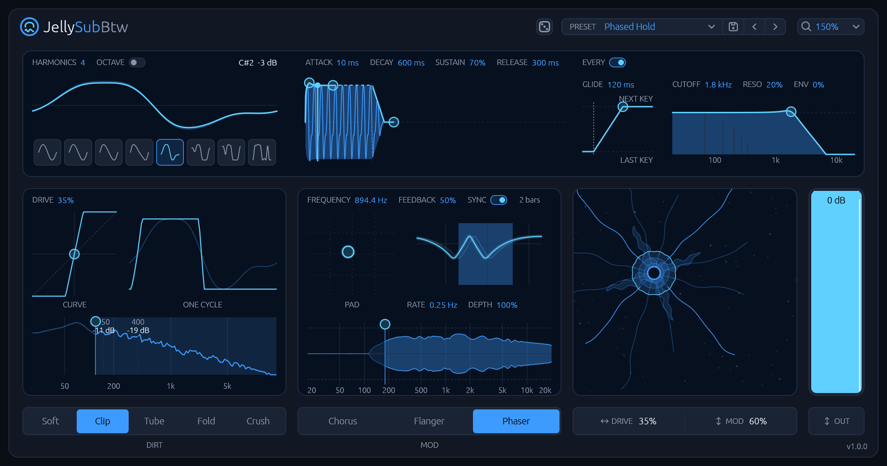

# JellySubBtw

**An 808 bass instrument with five kinds of dirt and one jellyfish pad.** A sine or a wave with more
harmonics rings out like an 808 or holds under an ADSR, glides into the next key, and one puck sets
how much dirt and how much chorus, flanger or phaser it gets. CLAP for Linux.



**[JellySubBtw on jelly-comet.github.io](https://jelly-comet.github.io/plugins/jellysubbtw/)**: more screenshots, the manual to read or as a PDF, and every release.

JellySubBtw plays one bass note at a time. A resonant low-pass shapes it, then one of five kinds of
dirt drives it (Soft, Clip, Tube, Fold, Crush), on the whole bass or only above the sub, and DRIVE
changes the tone without making it louder. After the dirt a chorus, a flanger or a phaser plays in a
band of its own, from 200 Hz up by default, so the sub stays in the middle and mono-safe. The DIRT
display reads how much of the note a laptop or phone speaker gets, so you can tell whether the bass
will be heard on one. It has no latency. It is not a kick drum and not a sampler: it plays one bass
voice from your notes.

**[Read the manual](manual.md)** for every control and how to use it.

## What it's for

- **Trap and drill 808s:** a long sine that rings out, a slide bent late into the next note, and a little dirt so it
  is heard on small speakers.
- **Sliding bass lines:** play a key under a held one and it glides, or turn EVERY on and every note slides from the
  last.
- **Distorted and growling sub bass:** clip, tube, fold or crush the note above the sub and keep the fundamental
  clean, with the low-pass opened by the note's envelope.
- **A wide bass that stays mono-safe:** chorus, flanger or phaser only above the sub, synced to the song.

## Features

- **One 808 voice:** one note at a time, a hit starting on its note with no pitch drop and no click. GLIDE from 0 to
  400 ms, bent early or late; OCTAVE keeps every key between B0 and A♯1.
- **An ADSR drawn as it sounds:** WAVE draws the chosen wave along the envelope, with grips to drag. SUSTAIN 0 rings
  out like an 808.
- **Eight waves:** a sine and seven waves with more and more harmonics.
- **A resonant low-pass into the dirt:** 24 dB an octave, RESO up to +17.7 dB at the cutoff, ENV opening it by up to
  5 octaves with the note's envelope.
- **Five kinds of dirt** in a band of their own: Soft, Clip, Tube, Fold and Crush. DRIVE keeps the loudness within
  0.2 LU from 0 to 100 %, so it changes the tone, not the level.
- **Chorus, flanger or phaser above the sub:** each with its own pad, RATE and DEPTH, and SYNC to lock the sweep to
  the song. With the band from 200 Hz the side stays 56 dB or more under the mid below 60 Hz.
- **The laptop check:** DIRT's spectrum marks 150 and 400 Hz and reads how much of the note a speaker that starts
  there gets.
- **Presets:** seven built in beside Init, your own, and a dice that rolls a new sound.
- **No latency.** Nothing passes 0 dBFS: a soft clip at full scale comes last.
- **Light:** 0.29 % of a CPU core at the defaults, 0.68 % with everything on, at 48 kHz.
- **Zoom** from 100 to 150 %.
- **No network access and no telemetry.**

## Install

Download the latest version from the [Releases page](https://github.com/jelly-comet/JellySubBtw-release/releases),
or with these commands:

```bash
curl -LO https://github.com/jelly-comet/JellySubBtw-release/releases/download/v1.0.0/JellySubBtw-1.0.0-linux-x86_64.tar.gz
curl -LO https://github.com/jelly-comet/JellySubBtw-release/releases/download/v1.0.0/JellySubBtw-1.0.0-linux-x86_64.tar.gz.sha256
sha256sum -c JellySubBtw-1.0.0-linux-x86_64.tar.gz.sha256 && tar xzf JellySubBtw-1.0.0-linux-x86_64.tar.gz
cd JellySubBtw-1.0.0-linux-x86_64
```

Install for your user:

```bash
mkdir -p ~/.clap
rm -f ~/.clap/JellySubBtw.clap && cp JellySubBtw.clap ~/.clap/
```

Or for all users:

```bash
sudo mkdir -p /usr/lib/clap
sudo rm -f /usr/lib/clap/JellySubBtw.clap && sudo cp JellySubBtw.clap /usr/lib/clap/
```

Removing the old copy first avoids overwriting a file a running host has loaded. Then rescan plugins
in your DAW.

To uninstall:

```bash
rm -f ~/.clap/JellySubBtw.clap
```

Your presets stay in `~/.local/share/JellySubBtw/presets/`; delete that folder too if you want them gone.

## Requirements

- Linux x86-64 on a CPU with AVX2 (Intel Core from 2013, AMD from 2015), with glibc 2.31 or newer (Ubuntu 20.04, Debian 11, Fedora 32 and newer)
- A CLAP host. Tried in Bitwig Studio and REAPER.
- X11 or XWayland, and a Vulkan driver for the editor

Releases contain the CLAP plugin only.

## FAQ

### Is it free?

Yes. The download is free and MIT-licensed.

### Is there a VST3 or LV2 version?

No. Releases contain the CLAP plugin only.

### Does it run on ARM, like a Raspberry Pi or Apple Silicon?

No. It needs Linux on x86-64, on a CPU with AVX2.

### Which hosts does it work in?

Any CLAP host. It was tried in Bitwig Studio and REAPER.

### Does it work on Wayland?

Through XWayland. The editor also needs a Vulkan driver.

### Does it make kick drums or play samples?

No. It plays one bass voice from your notes: a sine or a wave with more harmonics, with no pitch drop and no click
at its start. Put it beside your kick, not in its place.

## License

MIT, see [LICENSE](LICENSE). The licenses of the third-party code in the binaries are in
`THIRD-PARTY-LICENSES.txt` in each release archive.

VST is a registered trademark of Steinberg Media Technologies GmbH. CLAP is an open standard by the
free-audio project. Ableton Live is a trademark of Ableton AG; the MOD pads follow Live 9's layout and nothing
else. JellySubBtw is an independent project, not affiliated with or endorsed by Steinberg or Ableton, and "808"
names a kind of bass, not a product.
