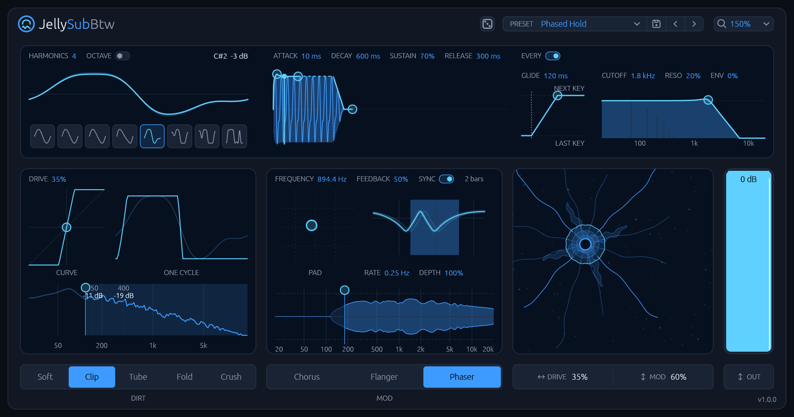
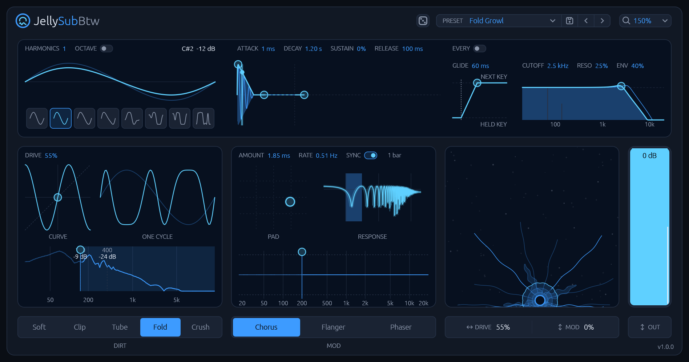
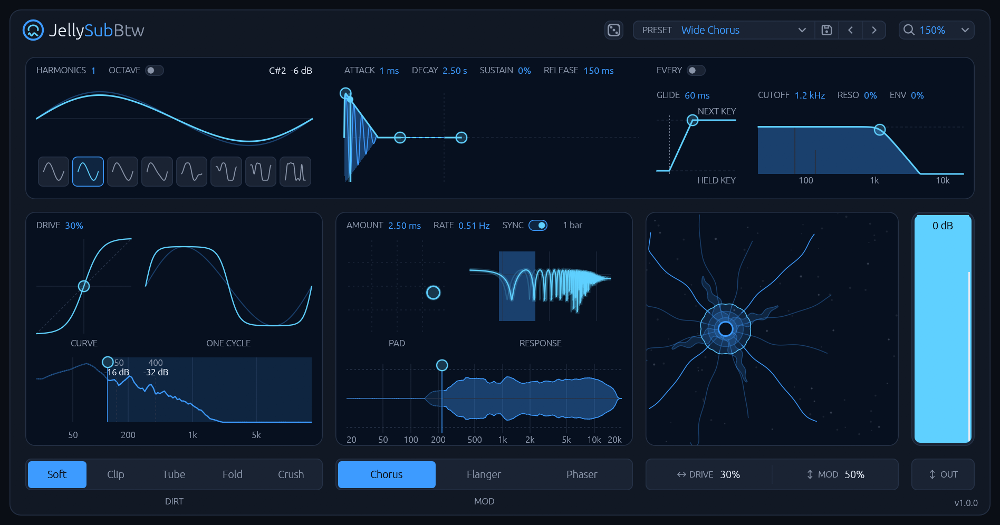

# JellySubBtw manual

**An 808 bass instrument with five kinds of dirt and one jellyfish pad.** A sine or a wave with more
harmonics rings out like an 808 or holds under an ADSR, glides into the next key, and one puck sets
how much dirt and how much chorus, flanger or phaser it gets.

Version 1.0.0. To install it, see the [install steps](README.md#install).

## Contents

- [Getting started](#getting-started)
- [The controls](#the-controls)
- [How to use it](#how-to-use-it)
- [Good to know](#good-to-know)
- [Troubleshooting](#troubleshooting)

## Getting started

Put JellySubBtw on an instrument track and play a bass line in the first two octaves. At the defaults
it is a clean sine that rings out like an 808, through a low-pass at 200 Hz. Then:

- Drag the puck on the jellyfish pad to the right for dirt (DRIVE), and up for the chorus (MOD).
- Pick another kind of dirt in DIRT: Clip or Fold for a hard, buzzy bass, Tube for a warm one.
- Press a key while another is held and the note slides into it.
- Or open PRESET and try the seven built-in sounds, or roll the dice beside it.

The window runs along the signal, left to right and top to bottom: the note (WAVE), the dirt (DIRT),
the effect (MOD), the pad and the level (OUT).



## The controls

From the left of WAVE to OUT, along the signal.

| Control | Range | Default | What it does |
| --- | --- | --- | --- |
| **HARMONICS** | 0 to 7 | 0 | The wave: 0 is a sine, 1 to 7 have more and more harmonics. Takes effect on the next hit. |
| **OCTAVE** | off, on | off | Keeps every key's fundamental between B0 and A♯1, wherever you play it. |
| **ATTACK** | 1 ms to 2 s | 1 ms | The rise to the peak. On WAVE: the peak's grip, dragged along. |
| **DECAY** | 10 ms to 8 s | 2.00 s | The fall to SUSTAIN. On WAVE: the knee's grip, along. |
| **SUSTAIN** | 0 to 100 % | 0 % | The level held while the key is. 0 rings out like an 808. On WAVE: the knee's grip, up. |
| **RELEASE** | 5 ms to 4 s | 60 ms | The fall after the key is let go. On WAVE: the end's grip, along. |
| **EVERY** | off, on | off | On: every note slides from the last one, not only a key pressed under a held one. |
| **GLIDE** | 0 to 400 ms | 60 ms | How long a slide takes; 0 jumps. Its plot's grip, along. |
| **SHAPE** | Late 100 % to Early 100 % | Straight | A slide's bend: Early rushes and settles, Late holds and swoops in. GLIDE's grip, up or down. |
| **CUTOFF** | 20 Hz to 20 kHz, Off | 200 Hz | The low-pass before the dirt, 24 dB an octave. Off, at the top, is no filter at all. Its grip, along. |
| **RESO** | 0 to 100 % | 0 % | The resonance at the cutoff, up to +17.7 dB. Its grip, up. |
| **ENV** | 0 to 100 % | 0 % | How far the note's envelope opens the low-pass, up to 5 octaves. |
| **DIRT** | Soft, Clip, Tube, Fold, Crush | Soft | The kind of dirt; each has a tooltip. |
| **DRIVE** | 0 to 100 % | 0 % | How hard the dirt is driven: the pad across, the grip in the middle of DIRT's curve, or DRIVE in the bar under the pad. 0 is the clean note. |
| **DIRT's band** | Off (20 Hz) to 20 kHz | Off | Where the dirt plays: above this edge, the clean note under it. Off is the whole bass. The round grip on DIRT's spectrum. |
| **MOD** | Chorus, Flanger, Phaser | Chorus | The effect after the dirt. |
| **MOD (mix)** | 0 to 100 % | 0 % | How much of the effect is heard inside its band: the pad up, or MOD in the bar under the pad. Hosts show it as Mod Mix. |
| **MOD's band** | Off (20 Hz) to 20 kHz | 200 Hz | Where the effect plays: under this edge always the dry note. The round grip on MOD's display. |
| **SYNC** | off, on | on | Each RATE snaps to the nearest of 1/8 note to 8 bars, and the sweep follows the song's position while it plays. |
| **Chorus AMOUNT, RATE** | 0 to 3.4 ms; 0.05 to 5 Hz | 1.85 ms; 0.51 Hz | The chorus's pad: how far its delay sweeps either way, and how fast. |
| **Flanger DELAY TIME, FEEDBACK** | 0.2 to 12 ms; 0 to 95 % | 1.58 ms; 50 % | The flanger's pad: the delay its sweep centres on, and the feedback. |
| **Flanger RATE, DEPTH** | 0.05 to 5 Hz; 0 to 100 % | 0.25 Hz; 100 % | The flanger's sweep, under its display. |
| **Phaser FREQUENCY, FEEDBACK** | 50 Hz to 20 kHz; 0 to 95 % | 894 Hz; 30 % | The phaser's pad: the frequency its sweep centres on, and the feedback. |
| **Phaser RATE, DEPTH** | 0.05 to 5 Hz; 0 to 100 % | 0.50 Hz; 100 % | The phaser's sweep, under its display. |
| **OUT** | −24 to 0 dB | 0 dB | The level into the last soft clip: the tall fader, or OUT under it. The fader's thin line is the output's peak; its top lights when the clip takes some off. |
| **SOUND** (the dice) | a button | | Rolls a new sound (see [The dice](#the-dice)). |
| **PRESET** | a list | Init | See [Presets](#presets). |
| **Zoom** | 100, 125, 150 % | 100 % | The window's size, kept with the project. |

**Mouse:** drag a value, a grip or a pad; hold Shift for fine steps; the scroll wheel steps;
double-click resets to the default; right-click a value to type it (`180 ms`, `2 s`, `1.2k`, `30%`).
A click anywhere on a pad moves its puck there. The host can automate every parameter.

## How to use it

### The note: WAVE

WAVE draws the note as your settings will make it: the chosen wave along the attack, decay, sustain
and release, stage by stage, and a dot riding the curve while a note sounds. Drag its three grips to
shape the envelope. With SUSTAIN at 0 the note rings out and dies on its own, the classic 808; raise
SUSTAIN for a bass that holds as long as the key.

HARMONICS picks the wave. A sine (0) is the pure sub, felt more than heard on small speakers; 1 to 3
add the overtones that make a bass audible on a laptop; 5 to 7 are bright and buzzy before any dirt.

### Slides

Press a key while another is held and the note slides to it over GLIDE, without a new hit. With
EVERY on, every note slides from the last one, even after a gap, as many trap 808s do. SHAPE bends
the slide: Late holds the old note and swoops in at the end, the typical 808 slide; Early rushes to
the new note and settles.

### The low-pass

CUTOFF and RESO set a 24 dB an octave low-pass before the dirt, on its own display at WAVE's right
end, with the note's partials drawn behind. Lower it to darken a wave with many harmonics before it
is driven; ENV opens it with each hit and closes it as the note dies, for a bass that growls on its
attack. At Off the filter is out of the way entirely.

### The dirt: DIRT

- **Soft:** a gentle rounding that thickens the note.
- **Clip:** hard edges, loud and buzzy, the clipped trap 808.
- **Tube:** a warm, uneven drive, like a valve.
- **Fold:** the wave folds over itself as DRIVE rises, a metallic growl.
- **Crush:** fewer bits and a slower clock, gritty and lo-fi.

DRIVE changes the tone and not the loudness: the dirt is held at the clean note's loudness, so you
can judge it by ear without being fooled by a louder signal.

DIRT's band keeps the dirt off the sub. Drag its round grip on the spectrum up to 120 or 150 Hz, and
the fundamental stays clean while everything above it is driven: a bass that is clean on a big
system and heard on a small one. Fold in particular can take the fundamental away on the whole bass;
give it a band.

**The laptop check:** DIRT's spectrum marks 150 Hz and 400 Hz, where a laptop and a phone speaker
start, and reads how much of the note gets through to each. If the readout is low, add HARMONICS or
DRIVE until it isn't.

### The effect: MOD

Pick Chorus, Flanger or Phaser. Each has its own small pad, laid out as in Ableton Live 9 (the
chorus's AMOUNT and RATE, the flanger's DELAY TIME and FEEDBACK, the phaser's FREQUENCY and
FEEDBACK), and its response beside it, moving with the sweep. The flanger and the phaser also have
RATE and DEPTH under the response.

The effect plays only above MOD's band edge, 200 Hz by default; under it the note stays dry and in
the middle, so the low end is as mono as before. Moving the edge under 200 Hz widens the low end;
from 100 Hz the side below 60 Hz is only 34 to 40 dB under the mid, where from 200 Hz it is 56 or
more.

With SYNC on (the default) every RATE snaps to a note length, and while the song plays the sweep
sits on its position, so the same bar sounds the same every time.

### The jellyfish pad

One puck for the two amounts that matter most: across is DRIVE, up is MOD's mix. Press anywhere on
the pad and the puck jumps there; drag it while a note plays to hear the bass go from clean to
dirty to wide. DRIVE and MOD are also in the bar under the pad to drag or type.



### OUT

The level into a soft clip at full scale, the last thing in the plugin: nothing passes 0 dBFS. At
OUT 0 dB, the default, a note at full velocity reaches the clip's knee and it rounds the peaks a
little, up to about 1.2 dB with the built-in presets. Its top lights when it does. Bring OUT down to
−3 dB if you want it untouched.

### Presets

The PRESET list holds Init (every default), your favourites, the seven built-in presets and then
your own. The arrows step through them, the disk saves the current settings under a name, and
PRESET reads `Custom` once a setting differs from every preset.

| Preset | What it is |
| --- | --- |
| Trap Glide | The long trap 808: a sine, no filter, a little Soft on the whole bass, a slide bent late. |
| Clipped Sub | Clip at DRIVE 60 % above 120 Hz: the fundamental clean, the clip heard on a laptop. |
| Warm Tube | Tube on HARMONICS 2 through a low-pass at 900 Hz, held a little. |
| Fold Growl | Fold above 150 Hz, the low-pass opened by the note's envelope: it growls as it hits. |
| Crushed Pluck | A short crushed pluck with a flanger above 300 Hz. |
| Wide Chorus | Soft on HARMONICS 1, a wide chorus above 220 Hz, the sub in the middle. |
| Phased Hold | A held, clipped bass with a slow phaser above 180 Hz and EVERY on. |



Your presets are text files in `~/.local/share/JellySubBtw/presets/`, one `id value` line a
parameter, shared by every project:

```text
drive 0.35
dirt soft
harmonics 0
```

A line a file doesn't have leaves its parameter alone, and a line it doesn't know is skipped.

### The dice

SOUND, left of PRESET, rolls every setting that shapes the sound: the wave, the envelope, the slide,
the filter, the dirt and the effect. It keeps OUT, OCTAVE, SYNC and EVERY as they are, and never
starts MOD's band under 100 Hz, so the sub stays in the middle. Roll until something sounds good,
then save it.

## Good to know

- **No latency:** a note sounds on its own sample, and the host has nothing to compensate.
- **Light:** about 0.29 % of a CPU core at the defaults and 0.68 % with everything on, at 48 kHz. In
  a long silence it costs next to nothing, and it tells the host when it is silent.
- **Click-free changes:** settings glide over 20 ms, a change of DIRT crossfades over 10 ms, a
  change of MOD over 20 ms, so you can automate them while notes play.
- **Velocity** spans 12 dB; the pitch wheel bends ±2 semitones.
- **Mono up to MOD, stereo after it.**
- **No oversampling,** for the zero latency: hard dirt on high notes aliases a little at 44.1 kHz,
  under −52 dB; on bass notes, and at 48 kHz, it stays under −60 dB.

## Troubleshooting

- **The plugin doesn't show up:** check that the bundle is in `~/.clap` or `/usr/lib/clap`, then
  rescan plugins in your DAW. It needs a CPU with AVX2.
- **The editor window stays black or doesn't open:** check that a Vulkan driver is installed. The
  `vulkaninfo` tool from `vulkan-tools` should list your GPU.
- **A note doesn't slide:** only a key pressed while another is held slides, unless EVERY is on;
  GLIDE 0 jumps.
- **The bass is thin with Fold:** on the whole bass Fold can take the fundamental away. Move DIRT's
  band up to 120 Hz or more.
- **The low end goes wide or thin in mono:** MOD's band reaches the sub. Keep its low edge at 200 Hz
  or over.
- **The fader's top lights up:** the last clip is rounding the peaks. Bring OUT down to −3 dB to
  keep it off.
- **The note sounds dull:** CUTOFF starts at 200 Hz. Turn it up, or all the way to Off.
- **Typing a preset's name does nothing:** some hosts keep keystrokes for themselves. Write the
  preset file by hand instead (see [Presets](#presets)).
- **A preset doesn't show up in the menu:** its file must end in `.preset`, and its name can't start
  with a dot or be Init's or a built-in preset's. The editor reads the folder when it opens and
  after a save, so reopen the editor after adding files by hand.
